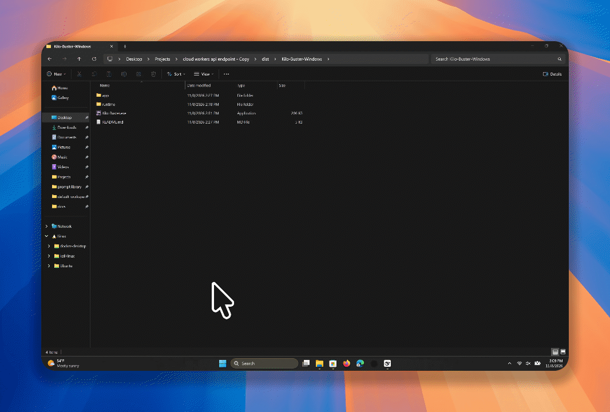

# Kilo Buster


## Demo



[Watch the full demo GIF](https://aaronwiseai.com/aidocs/Recording_11_8_2026_3_11_13_PM.gif)

A local OpenAI-compatible chat API with a dashboard for loading and monitoring HTTP proxies. Kilo Buster starts with **zero proxies**. Click **Load proxies** to fetch the configured remote list. Entries are added one at a time, and repeated host/port addresses are skipped, including when you click again. Credentials in proxy URLs are supported and are not displayed on the dashboard.

## Get started

Download the archive for your operating system from GitHub Releases and extract it to a writable folder.

## Downloads

Use the latest release page for the current packages.

- [Windows](https://github.com/AaronWiseAI/Kilo-Buster/releases/latest) — `Kilo-Buster-Windows.zip`
- [Linux x86_64](https://github.com/AaronWiseAI/Kilo-Buster/releases/latest) — `Kilo-Buster-Linux.tar.gz`
- [macOS Apple Silicon](https://github.com/AaronWiseAI/Kilo-Buster/releases/latest) — `Kilo-Buster-macOS-Apple-Silicon.tar.gz`
- [macOS Intel](https://github.com/AaronWiseAI/Kilo-Buster/releases/latest) — `Kilo-Buster-macOS-Intel.tar.gz`

The release page also includes SHA-256 checksums when a tagged build is published.

- **Windows:** run `Kilo-Buster.exe`. Keep its console window open. The archive includes the required Node runtime.
- **macOS and Linux:** in a terminal, enter the extracted folder and run `./start.sh`. If necessary, first run `chmod +x start.sh runtime/node`.

The dashboard opens at `http://127.0.0.1:43817/dashboard`. Click **Load proxies** before sending requests. The dashboard displays your API key (use Show or Copy key), and the console displays the key and base URL. The key is generated once and reused across restarts. Close the console or press Ctrl+C to stop. Each restart starts with no proxies; load the list again when needed. The hourly quota panel shows attempts used and remaining across loaded proxies, based on a rolling 60-minute window. Retries count as attempts, and proxies cooling down may temporarily reduce the capacity available right now. The dashboard also shows lifetime input, output and total reported tokens and estimates avoided API cost using editable comparison rates. Defaults use GPT-5.4 mini standard rates ($0.75 input and $4.50 output per million tokens, checked November 8, 2026); see [OpenAI pricing](https://openai.com/index/introducing-gpt-5-4-mini-and-nano/). This is an estimate, assumes free Kilo token usage, and excludes proxy fees, caching, taxes and other costs. Usage is counted only when the upstream reports it.

## Run from source

On macOS, open **Kilo Buster.app** from the extracted release folder. On Linux, run `./install-desktop.sh` from that folder to add Kilo Buster and its icon to the applications menu. Keep the extracted folder in place after installing the launcher.

Install Node.js 22.13 or newer and run `npm ci`. On Windows, run `start-kilo-api.bat`; on macOS or Linux run `chmod +x start.sh && ./start.sh`. You can also run `npm start`, then open the dashboard URL printed in the console. Set `API_AUTH_TOKEN` to override the saved key.

Set your client to base URL `http://127.0.0.1:43817/v1`, bearer token from the console, and model `kilo-auto/free`. Example (replace the token):

```sh
curl http://127.0.0.1:43817/v1/chat/completions \
  -H 'Authorization: Bearer YOUR_TOKEN' -H 'Content-Type: application/json' \
  -d '{"model":"kilo-auto/free","messages":[{"role":"user","content":"Hello!"}]}'
```

Supports model discovery and chat completions, including streaming and tool calls. Requests are routed through loaded proxies to Kilo and the model is forced to `kilo-auto/free`. A list entry must be an HTTP(S) proxy URL or `host:port`, optionally with credentials. Invalid lines are skipped. The import needs internet access; an error leaves existing proxies in place.

## Data and configuration

The release contains no proxy list, saved requests, token totals, or health history. After use, aggregate token counts, rolling request quotas, and health statistics are stored locally in `proxy-health-state.json` and its SQLite companion; request bodies are not saved. Delete those files while the application is stopped to reset statistics. Proxies themselves are never restored automatically and must be loaded on each startup. The remote source can change; review and trust the proxy provider before use, since proxies carry your traffic. Kilo and upstream providers receive your prompts.

The key is stored in `~/.kilo-buster/api-key` (on Windows, under your user profile). Keep it private. To generate a new key, stop Kilo Buster and delete that file; clients will need the new key. An explicitly supplied `API_AUTH_TOKEN` overrides the saved key.

Environment variables: `PORT` (default `43817`), `HOST` (default `127.0.0.1`), `API_AUTH_TOKEN`, `KILO_API_KEY`, `PROXY_STATE_FILE`, `PROXY_REQUESTS_PER_HOUR` (maximum 149), `PROXY_RETRIES`, and `PROXY_BACKOFF_SECONDS`. The API supports cross-origin requests; keep the token private and avoid exposing the listener to untrusted networks. Dashboard URLs contain the token, so treat them as secrets.

## Building releases

The GitHub Actions workflow builds Windows, Linux, and both Apple Silicon and Intel macOS archives. Run it manually for downloadable artifacts, or push a `v*` tag to attach the archives to a GitHub release. Windows ships an executable launcher and a private Node runtime; macOS and Linux archives contain a launch script and runtime. The project is not affiliated with Kilo.
